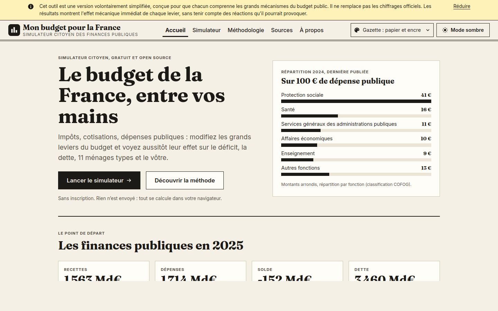
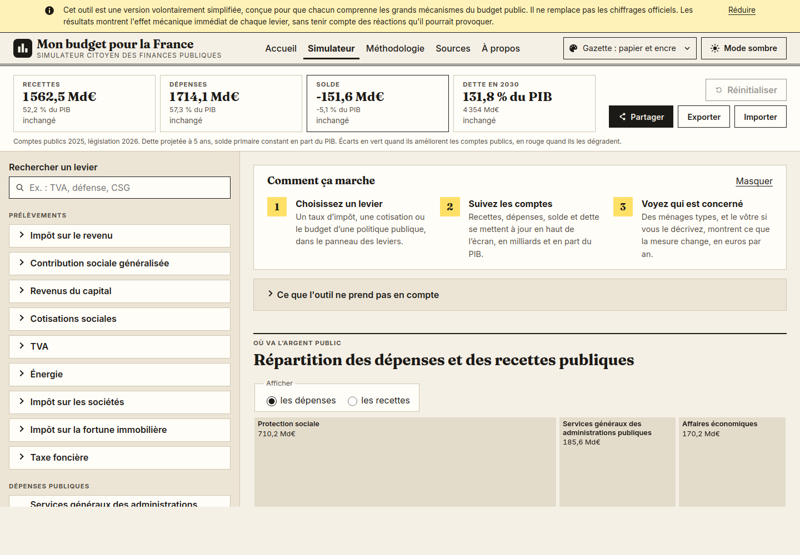
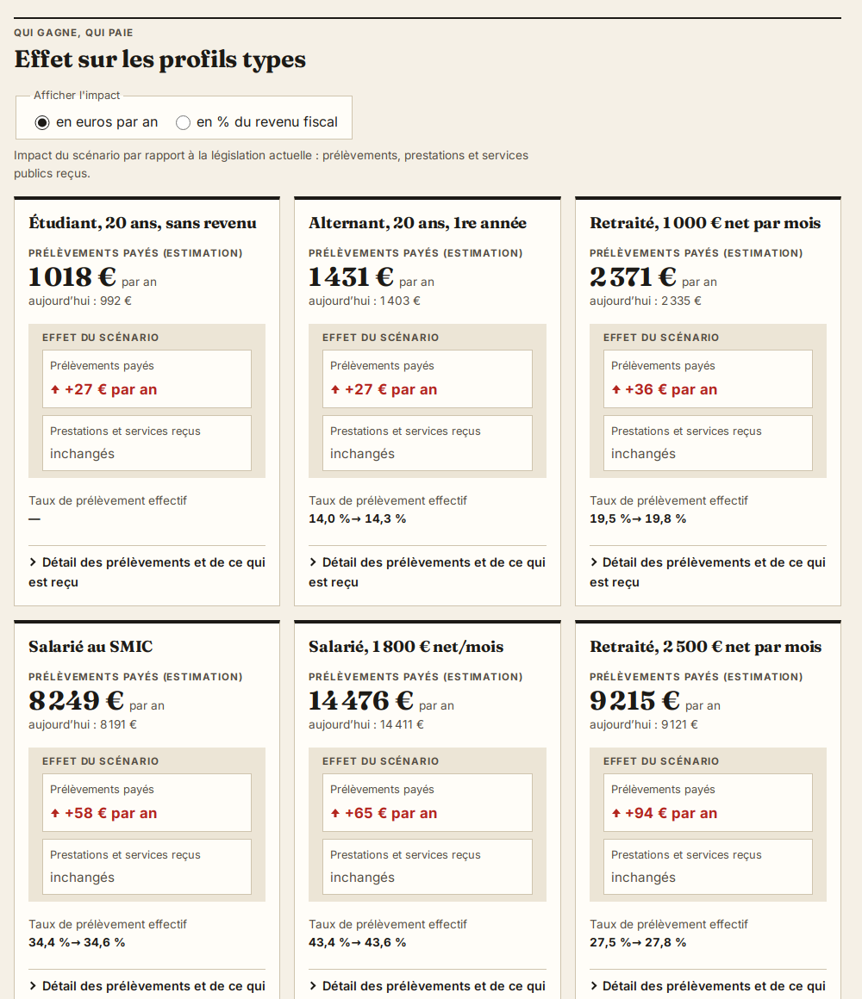

# Mon budget pour la France

Simulateur budgétaire citoyen, statique et open source. Il montre l'effet mécanique
immédiat des principaux leviers de prélèvements et de dépenses publiques sur :

1. les grands agrégats (recettes, dépenses, solde, dette, en Md€ et en % du PIB, trajectoire de
   la dette à cinq ans) ;
2. onze profils types de ménages, et le foyer que décrit l'utilisateur.

> Cet outil est une version volontairement simplifiée, conçue pour que chacun comprenne les
> grands mécanismes du budget public. Il ne remplace pas les chiffrages officiels. Les résultats
> montrent l'effet mécanique immédiat de chaque levier, sans tenir compte des réactions qu'il
> pourrait provoquer.

**Site : <https://dedaluscode.github.io/MonBudgetPourLaFrance/>**



## Objectif

Rendre lisible le budget des administrations publiques pour un public sans connaissance en
finances publiques : ce que rapporte chaque prélèvement, ce que coûte chaque politique publique,
et ce qu'un changement de taux ou de dépense modifie pour l'État et pour un ménage.

Quatre principes guident le projet (détaillés dans [PLAN.MD](PLAN.MD)) :

- **Neutralité.** Les leviers sont des paramètres, pas des propositions. Les curseurs vont de 0 à
  2 fois la valeur actuelle, aucun scénario n'est attribué à un parti, aucun texte ne qualifie une
  mesure de bonne ou de mauvaise.
- **Transparence.** Chaque valeur chiffrée renvoie à une source officielle datée ; les hypothèses
  de modélisation sont signalées comme telles et expliquées dans la page Méthodologie.
- **Symétrie.** Chaque profil paie des prélèvements et reçoit des prestations et des services
  publics : une baisse de dépense réduit ce qu'il reçoit.
- **Simplicité assumée.** Effets statiques uniquement : ni changement de comportement, ni
  bouclage macroéconomique.

| Simulateur | Effet d'un scénario sur les profils types |
|---|---|
|  |  |

## Fonctionnalités

- **Leviers** : impôt sur le revenu (taux des tranches, indexation du barème), CSG, prélèvement
  forfaitaire unique, TVA, accises sur l'énergie, impôt sur les sociétés, IFI, cotisations sociales
  une par une (dont celles des employeurs publics), taxe foncière, et les dépenses des 10 fonctions,
  69 groupes et 314 postes de la classification COFOG (prestations sociales comprises). Chaque
  levier a une fenêtre explicative (« ? ») avec ses sources et ce que change une variation à la
  hausse et à la baisse.
- **Niveau de détail** : Essentiel (10 fonctions, 13 grands prélèvements), Détaillé, Expert ;
  changer de niveau n'efface aucune modification.
- **Synthèse** : recettes, dépenses, solde et dette dans cinq ans, avec l'écart au scénario actuel.
- **Bilan** : la liste des mesures du scénario avec l'effet de chacune, les totaux et l'effet sur
  les profils, sans score ni verdict ; sous chaque curseur modifié, un texte d'impact (dont un
  ordre de grandeur en postes à temps plein pour les dépenses de personnel).
- **Treemap** des dépenses et des recettes, zoomable, utilisable au clavier, avec un tableau
  équivalent.
- **Profils types** : étudiant, alternant, salariés (SMIC, 1 800 €, cadres à 3 000 € et
  10 000 € net par mois), retraités, artisan, revenus du capital et très grand patrimoine ; prélèvements
  payés, prestations et services reçus, taux de prélèvement effectif.
- **Votre foyer** : un ou deux adultes (salarié, alternant, agent public, artisan ou commerçant,
  agriculteur, profession libérale, micro-entrepreneur, étudiant, retraité, au chômage, sans
  activité ; handicap, invalidité), enfants, statut matrimonial, logement ; le moteur calcule
  les cotisations, l'impôt et les aides selon les revenus (prestations familiales, prime
  d'activité, RSA, AAH, ASPA, ASS, aides au logement, bourses, chèque énergie, complémentaire
  santé solidaire), en supposant qu'elles sont demandées. Ces données restent dans le navigateur
  et ne sont jamais transmises.
- **Partage** : le scénario est enregistré dans l'adresse de la page (`#s=…`) et s'exporte ou
  s'importe en JSON.
- **Accessibilité** : navigation complète au clavier, contrastes WCAG AA vérifiés par les tests,
  couleurs toujours doublées d'un signe et d'une flèche ; quatre thèmes graphiques, clairs et
  sombres.

## Lancement local

Prérequis : Node.js 22.18 ou plus récent, car les scripts sont exécutés directement en
TypeScript. La version utilisée en CI est indiquée dans `.nvmrc`.

```sh
npm install
npm run dev            # serveur de développement
npm test               # tests (Vitest) ; npm run test:watch en continu
npm run test:coverage  # tests avec couverture (≥ 90 % sur le moteur, exécuté en CI)
npm run lint           # ESLint + Prettier ; npm run format corrige la mise en forme
npm run typecheck      # svelte-check (TypeScript strict)
npm run validate:data  # schémas des données, sources, nombre de valeurs à vérifier
npm run docs:profiles  # régénère docs/reference-profiles.md (bilan des profils types)
npm run build          # build de production dans dist/ ; npm run preview pour le servir
```

Un seul fichier de test : `npx vitest run tests/engine/simulate.test.ts` ; un seul test : ajouter
`-t "<nom du test>"`.

## Architecture

Site statique : aucun serveur, aucun appel réseau à l'exécution, toutes les données sont
embarquées au build. Pile : Vite, TypeScript strict, Svelte 5, Vitest, Zod, d3-hierarchy.

```
src/
├─ engine/            calcul pur, sans aucune dépendance à l'interface
│  ├─ household/      un module par prélèvement ou prestation : (revenus, règles) => résultat
│  ├─ rules.ts        données sourcées → nombres utilisés par le calcul
│  ├─ levers.ts       catalogue des leviers : bornes, effet sur les recettes, effet sur les ménages
│  ├─ profiles.ts     revenus, prélèvements et services reçus d'un profil type
│  ├─ customHousehold.ts  le foyer décrit par l'utilisateur
│  ├─ inKind.ts       services publics reçus (clés de répartition par fonction COFOG)
│  ├─ incidence.ts    qui supporte quel prélèvement (paramètre des données)
│  ├─ macro.ts        solde et trajectoire de la dette
│  └─ simulate.ts     point d'entrée : createModel(données) puis simulate(modèle, scénario)
├─ data/              données sourcées (JSON), voir ci-dessous
└─ ui/                interface Svelte : components/, pages/, state/ (scénario, URL, thème)
scripts/              validation des données, bilan des profils, validation croisée OpenFisca
tests/                engine/, data/, ui/ ; fixtures/ contient les cas officiels rejoués
```

Le moteur ne connaît pas l'interface : `simulate()` prend un scénario
`{ schemaVersion, baseYear, levers: { id: valeur absolue } }` et renvoie les agrégats, la
trajectoire de la dette et le résultat de chaque profil, en moins de 5 ms. Les identifiants de
leviers (`vat.standard`, `spending.cofog.07.1`…) sont stables : un lien partagé reste valable
d'une version à l'autre.

Les calculs des ménages sont testés sur des cas chiffrés officiels (API mon-entreprise de
l'Urssaf, exemples du BOFiP, de service-public.fr et de la CAF) et comparés à OpenFisca-France
(voir plus bas). Le détail des formules et des hypothèses est dans la page
[Méthodologie](https://dedaluscode.github.io/MonBudgetPourLaFrance/#/methodologie) du site.

## Données

Les données sont dans `src/data/*.json`. Chaque valeur chiffrée a la forme
`{ value, unit, sourceId, asOf, status, note }` :

- `status` vaut `VERIFIE` (repris d'une source), `A_VERIFIER` ou `HYPOTHESE` (choix de
  modélisation, même calculé à partir de valeurs sourcées) ; l'interface signale les deux derniers ;
- `sourceId` renvoie à `src/data/sources.json` (URL officielle et date de consultation) ;
- une valeur calculée donne sa formule dans `note`.

| Fichier | Contenu |
|---|---|
| `meta.json` | version des données, année des comptes, année de la législation |
| `macro.json` | PIB, dette, recettes et dépenses totales, charge d'intérêts, prévision de l'année suivante |
| `revenues.json` | recettes publiques par prélèvement (base brute), dont la somme égale les recettes totales |
| `spending.json` | dépenses par fonction COFOG (10 divisions, 69 groupes, postes de niveau 3), coefficient de recalage, rémunérations et coût moyen d'un poste |
| `taxRules.json` | barèmes, taux, plafonds et seuils de la législation en vigueur, hypothèses d'incidence |
| `profiles.json`, `consumption.json` | profils types et structure de leur consommation |
| `inKindAllocation.json` | répartition des services publics entre les profils |
| `explanations.json` | textes des fenêtres explicatives : un par levier, et un modèle par nature de dépense (personnel, achats…) pour les postes par nature |
| `sources.json` | registre de toutes les sources |

Les schémas sont dans `src/engine/schemas.ts`. `npm run validate:data` les vérifie (exécuté en
CI), contrôle que chaque source citée existe et affiche le nombre de valeurs à vérifier ;
`node scripts/validate-data.ts --list` les liste une à une. `tests/data/consistency.test.ts`
vérifie que la somme des recettes et celle des dépenses par fonction retombent sur les totaux.

### Mettre à jour les données à chaque loi de finances

1. **Législation** (après la loi de finances et la loi de financement de la sécurité sociale) :
   mettre à jour `taxRules.json` (barème de l'impôt sur le revenu, SMIC, plafond de la sécurité
   sociale, taux de cotisations, accises…) avec les nouvelles sources et `asOf` = date d'entrée en
   vigueur, puis `baseYear` dans `meta.json`.
2. **Comptes publics** (compte provisoire de l'INSEE au printemps, semi-définitif à la fin de
   l'été, notification Eurostat d'octobre) : mettre à jour `macro.json` et `revenues.json`, puis
   `accountsYear` dans `meta.json`.
3. **Dépenses par fonction** : la ventilation COFOG est publiée un an après les comptes. En
   attendant, `spending.json` garde la dernière année publiée (`structureYear`) et `scaling`
   (total des dépenses de l'année des comptes / de l'année de structure) la ramène au total
   récent. Quand la nouvelle ventilation paraît, remplacer les montants, mettre `structureYear` à
   jour et `scaling` à 1.
4. **Sources** : ajouter chaque nouvelle source à `sources.json` et mettre à jour les `sourceIds`
   de `explanations.json` si un texte cite une règle modifiée.
5. **Contrôles** : `npm run validate:data`, `npm test` (les cas officiels de `tests/fixtures/`
   correspondent à une année de législation : rejouer les simulations de l'Urssaf et reprendre
   les exemples publiés), `npm run docs:profiles`, puis la validation croisée OpenFisca après avoir
   mis à jour la version épinglée dans `scripts/openfisca-check/requirements.txt`.
6. Incrémenter `dataVersion` dans `meta.json`.

## Validation croisée avec OpenFisca-France

Les cotisations, la CSG, l'impôt sur le revenu (avec quotient familial), la prime d'activité et
les allocations familiales calculés par le simulateur sont comparés à ceux d'
[OpenFisca-France](https://github.com/openfisca/openfisca-france), le moteur de calcul
socio-fiscal ouvert de référence, sur les profils salariés et retraités et sur cinq foyers avec
enfants.

```sh
npm run openfisca:export                                   # cas et résultats du simulateur
python3 -m venv .venv && .venv/bin/pip install -r scripts/openfisca-check/requirements.txt
.venv/bin/python scripts/openfisca-check/compare.py        # rapport dans scripts/openfisca-check/out/
```

Le workflow [.github/workflows/openfisca-check.yml](.github/workflows/openfisca-check.yml)
exécute cette comparaison à chaque push, sans bloquer le déploiement, et publie le rapport
(artefact `rapport-openfisca` et résumé du job). Les écarts dont la cause est connue y sont
expliqués (prestations que le simulateur ne modélise pas, règle appliquée différemment).

## Déploiement sur GitHub Pages

Le workflow [.github/workflows/deploy.yml](.github/workflows/deploy.yml) exécute le lint,
la vérification des types, la validation des données, les tests et le build à chaque push et
pull request, puis déploie le site à chaque push sur `main`.

**Activation (une seule fois) :** dans le dépôt GitHub, ouvrir
**Settings → Pages → Build and deployment → Source** et choisir **GitHub Actions**.

Le site est servi sous `https://<compte>.github.io/<nom-du-dépôt>/`. Le chemin de base est
transmis à Vite par la variable d'environnement `BASE_PATH` (voir `vite.config.ts`) ;
le workflow la renseigne automatiquement avec le nom du dépôt.

## Limites et hors périmètre

Le simulateur ne prend pas en compte :

- les changements de comportement (optimisation fiscale, départs ou arrivées de contribuables,
  variation de la consommation, du travail ou de l'investissement) et les élasticités ;
- les effets sur la croissance (bouclage macroéconomique) ;
- les effets de calendrier et la trajectoire pluriannuelle des mesures ;
- la diversité réelle des situations : les profils sont des cas types fictifs ;
- les liens entre prestations : chaque prestation est modifiée seule (baisser l'allocation
  chômage ne recalcule pas le RSA) ;
- le non-recours aux aides : celles de « Votre foyer » sont calculées comme si elles étaient
  demandées ;
- l'organisation des services : les postes à temps plein affichés sont un ordre de grandeur
  mécanique.

Ne sont pas modélisés : les configurations familiales plus fines que celles du formulaire
« Votre foyer » ; les profils types de micro-entrepreneur, d'agent public et de fonctionnaire
retraité (ces situations sont disponibles dans « Votre foyer ») ; les aides qui dépendent d'un plan
individuel, du département ou du mode de garde (PCH, APA, complément de libre choix du mode de
garde, aides locales), expliquées mais non calculées ; le congé parental ;
la cotisation foncière des entreprises (CFE) de l'artisan ; les droits de succession et de
donation ; le détail des collectivités ; la contribution différentielle sur les hauts revenus
comme levier (faute de chiffrage sourcé de son rendement) ; la comparaison internationale.

## Feuille de route

- **v1.1** (publiée, [plan détaillé](PLAN.MD) §13) : niveau de détail, troisième niveau de
  dépenses et prestations, situations et aides de « Votre foyer », bilan du scénario et textes
  d'impact, fenêtres explicatives de tous les leviers.
- **Programmes** : chaque programme pourra être exprimé comme un fichier de scénario, dans le
  même format que les liens partagés, avec les sources justifiant chaque valeur.

## Historique des versions

Les évolutions sont consignées dans [CHANGELOG.md](CHANGELOG.md), affiché dans la page
« Nouveautés » du site ; la version en cours figure en bas de chaque page. Les rubriques
« Données » et « Méthode » signalent les changements qui font varier les chiffres.

## Contribuer

Les signalements d'erreurs de données et les propositions de leviers sont les bienvenus : voir
[CONTRIBUTING.md](CONTRIBUTING.md) et les modèles d'issues du dépôt.

## Licence

- **Code** : [GNU Affero General Public License v3.0](LICENSE) ou toute version ultérieure
  (`AGPL-3.0-or-later`). Une version modifiée mise en ligne doit publier son code source.
- **Données** (`src/data/`) et documentation : [Licence Ouverte / Open Licence 2.0](LICENSE-DATA.md)
  d'Etalab. Toute réutilisation doit mentionner la source et la date de mise à jour. Les données
  publiques reprises restent soumises aux conditions de leurs producteurs (INSEE, DGFiP, Urssaf…),
  cités dans `src/data/sources.json`.
